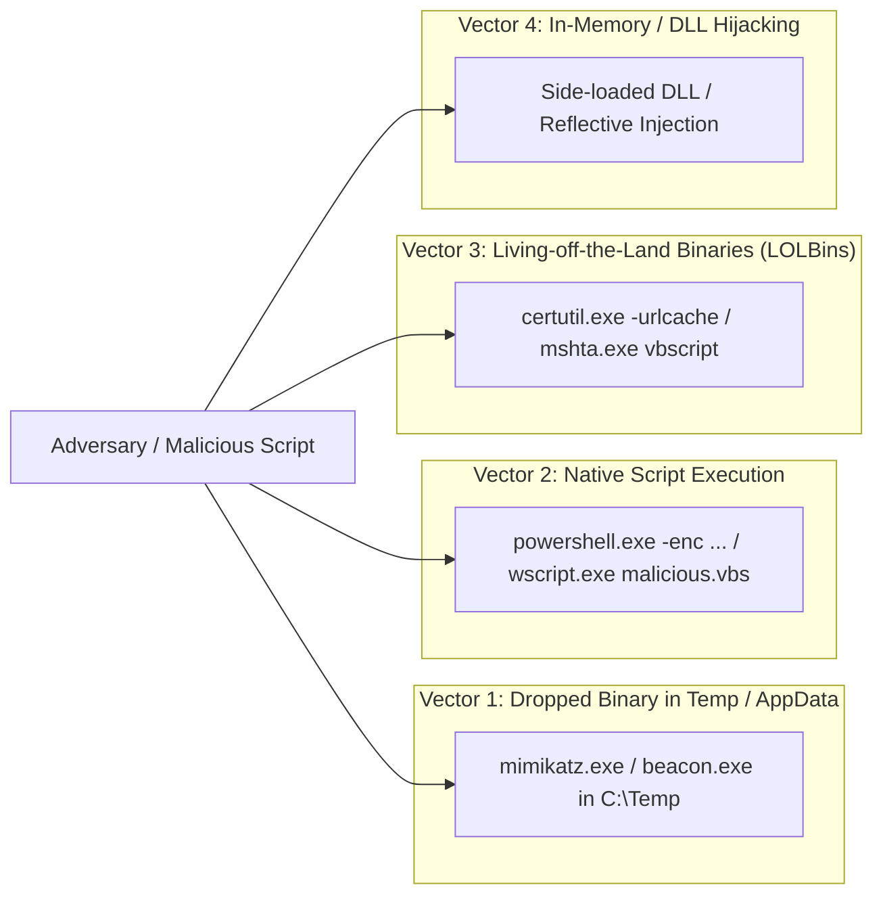
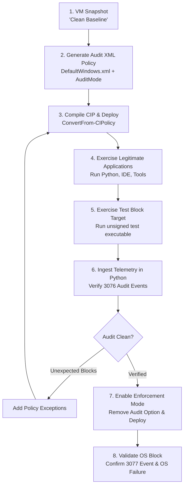
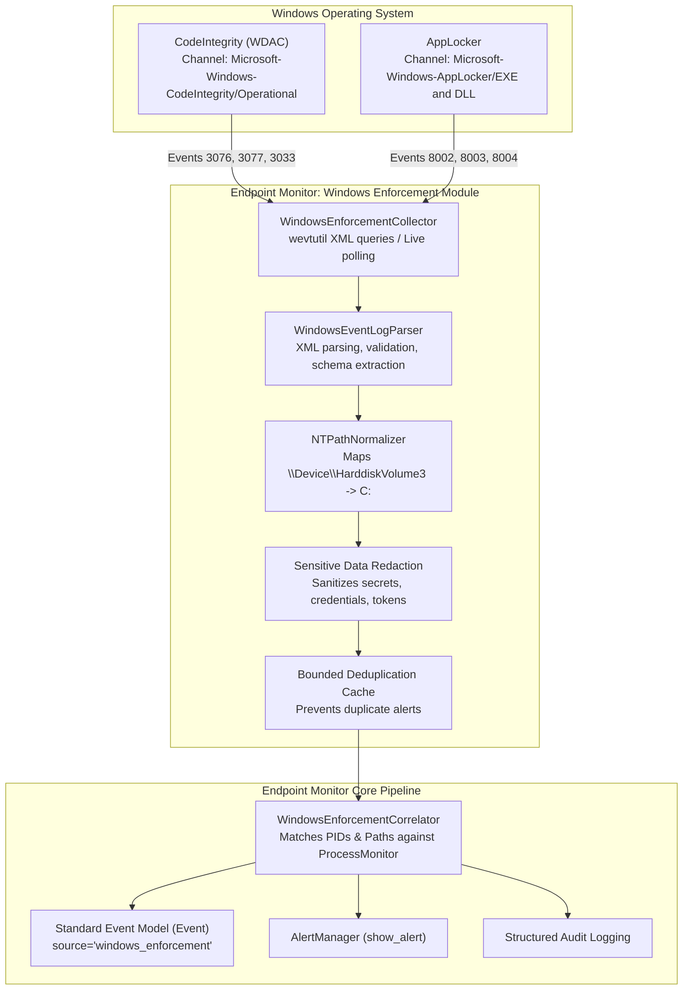

# Phase 4 — OS-Level Execution Prevention Architecture and Design

## 1. Executive Summary

The **Endpoint Monitor** project has achieved stable controlled execution within the application runtime through Phases 1–3:
- **Phase 1**: Execution foundation, policy contracts, and safety gating.
- **Phase 2**: Controlled launcher (`src/execution/launcher.py`) with canonical binary resolution, bounded I/O, timeouts, and working directory lockdown.
- **Phase 3**: Execution orchestration service (`src/execution/service.py`) with sensitive data redaction, dual-gate safety (`dry_run=True`, `allow_active_execution=False`, `interception_enabled=False`), ordered audit telemetry, and alert deduplication.

**Phase 4** addresses the central architectural limitation: *the existing service only mediates execution requests explicitly routed through the Python application.* Any process spawned externally (via PowerShell, CMD, Windows Explorer, scheduled tasks, or third-party software) bypasses application-level gating.

This document establishes the architecture, threat model, mechanism evaluation, test strategy, safe recovery procedures, and Python telemetry integration to bridge application monitoring with OS-level application control on Windows 11.

---

## 2. The Three Execution Control Tiers

To avoid conflating passive observation with active gating, the project defines three distinct tiers of execution control:

```mermaid
flowchart TD
    subgraph TierA["Tier A: Controlled Application Execution"]
        Req[ExecutionRequest] --> Gating[Policy & Dual Gate]
        Gating -->|Approved & Active| Launcher[ControlledLauncher / Subprocess]
        Gating -->|Blocked / Dry-Run| Deny[Suppressed / Logged]
    end

    subgraph TierB["Tier B: OS-Enforced Application Control"]
        OSLaunch[External Process Launch<br/>CMD, PowerShell, Explorer, WMI] --> KernelGate[Windows Kernel / CI.dll / AppLocker]
        KernelGate -->|Policy Allowed| OSExec[Process Executes]
        KernelGate -->|Policy Blocked| OSBlock[Access Denied / Blocked]
        KernelGate -.->|Audit / Enforce Event| WinEventLog[Windows Event Log<br/>CodeIntegrity / AppLocker]
    end

    subgraph TierC["Tier C: Dynamic Risk-Based Prevention (Future/Advanced)"]
        PreSpawn[Pre-Exec Kernel Hook<br/>ProcessNotify / Minifilter] --> Intercept[Synchronous Query to Python]
        Intercept --> RiskCalc[RiskEngine & Policy]
        RiskCalc -->|Score < 7| AllowSpawn[Resume Process]
        RiskCalc -->|Score >= 7| AbortSpawn[Abort Process Creation]
    end
```



| Tier | Capability | Enforcement Point | Mechanism | Coverage Scope | Risk Engine Invocation |
| :--- | :--- | :--- | :--- | :--- | :--- |
| **Tier A** | **Controlled Application Execution** | Python Application Space | `ControlledExecutionService` + `ControlledLauncher` | Processes spawned deliberately via Python | **Yes** (Synchronous, per-request) |
| **Tier B** | **OS-Enforced Application Control** | Windows Kernel / Subsystem | Windows App Control for Business (WDAC) / AppLocker | **All** binaries/scripts on endpoint | **No** (Static policy enforced by Windows) |
| **Tier C** | **Dynamic Risk-Based Prevention** | OS Kernel Interception | Custom Kernel Callback / Driver | System-wide pre-execution | **Yes** (Real-time OS callback into risk engine) |

### Key Architectural Principle
**Tier A cannot provide Tier B or Tier C.** Tier B provides system-wide prevention, but enforcement decisions are evaluated by Windows against pre-compiled static cryptographic/path policies—not dynamically by the Python risk detector. The Python security system integrates with Tier B via **evidence-based telemetry correlation** (Phase 4C).

---

## 3. Windows Application Control Mechanism Evaluation

To establish Tier B OS-level application control, two native Windows mechanisms were evaluated for Windows 11:

### 3.1 Microsoft App Control for Business (WDAC)

- **Architecture**: Implemented at the kernel code-integrity layer (`ci.dll`, Secure Kernel / VBS). Enforces code signing, catalog verification, and path/hash policies before code pages are mapped into memory.
- **Enforcement Scope**: Native PE binaries (EXE, DLL), kernel drivers (SYS), and script hosts supporting Windows Constrained Language Mode (PowerShell, MSHTA, WScript, CScript).
- **Telemetry Channels**:
  - `Microsoft-Windows-CodeIntegrity/Operational`
  - Event ID `3076`: Audit Mode block (file would have been blocked).
  - Event ID `3077`: Enforce Mode block (file was blocked from executing).
  - Event ID `3089`: Correlated signature and publisher verification details.
  - Event ID `3033` / `3034`: Signing level validation blocks/audits.
- **Strengths**:
  - Kernel-enforced: resilient against user-mode tampering and administrative bypass when policy is signed.
  - Transparent support for multiple active policies on Windows 11 (Base policy + Supplementary policies).
  - Enforces Constrained Language Mode (CLM) on PowerShell, preventing script-based memory injection.
- **Weaknesses & Constraints**:
  - Authoring requires administrative privileges and deployment of compiled binary `.cip` files into `C:\Windows\System32\CodeIntegrity\CiPolicies\Active\`.
  - Misconfiguration risks system instability or developer lockout if critical binaries or drivers are blocked.
  - Official full support is geared toward Windows 11 Pro, Enterprise, and Education editions.

### 3.2 AppLocker

- **Architecture**: Implemented via kernel filter driver `appid.sys` and the Application Identity user-mode service (`AppIDSvc`).
- **Enforcement Scope**: Executables (`.exe`), DLLs (`.dll`, `.ocx`), Windows Installer packages (`.msi`, `.msp`), and scripts (`.ps1`, `.bat`, `.cmd`, `.vbs`, `.js`).
- **Telemetry Channels**:
  - `Microsoft-Windows-AppLocker/EXE and DLL` (Event IDs `8002` Allowed, `8003` Audit Block, `8004` Enforce Block).
  - `Microsoft-Windows-AppLocker/MSI and Script`.
- **Strengths**:
  - Simpler rule authoring (path, file hash, publisher) through Group Policy (`gpedit.msc`) or PowerShell (`New-AppLockerPolicy`).
  - Native distinction between script and executable rule collections.
- **Weaknesses & Constraints**:
  - **Edition Restriction**: AppLocker rule *enforcement* requires Windows Enterprise or Education edition. On Windows Home and basic Pro editions, AppLocker rules are ignored or audit-only.
  - Bypass resistance: User-mode components and common Living-Off-The-Land Binaries (LOLBins) can bypass path-only AppLocker rules without Constrained Language Mode.

### 3.3 Mechanism Decision Matrix

| Criterion | Microsoft App Control (WDAC) | AppLocker | Decision / Rationale |
| :--- | :--- | :--- | :--- |
| **Security Boundary** | Kernel / Hypervisor (CI.dll) | Kernel Filter + Userland Service | **WDAC selected** as primary target for enterprise security. |
| **Windows Edition Support** | Windows 11 Pro/Enterprise (Kernel CI active across all builds) | Windows 11 Enterprise/Education for enforcement | **WDAC preferred**; AppLocker cannot enforce on Home edition. |
| **Tamper Resistance** | High (Can be UEFI-signed) | Moderate (Relies on service & ACLs) | **WDAC selected**. |
| **Script Sandboxing** | Auto-enforces CLM in PowerShell | Separate script rules | **WDAC selected**. |
| **Telemetry Support** | Event IDs 3076, 3077, 3089, 3033 | Event IDs 8001, 8002, 8003, 8004 | **Both supported** in Python integration pipeline. |

**Selected Approach**: Establish **Microsoft App Control for Business (WDAC)** as the primary target mechanism, while engineering the Python telemetry layer (`src/execution/windows_enforcement.py`) to parse, normalize, and correlate events from **both** WDAC (`Microsoft-Windows-CodeIntegrity`) and AppLocker (`Microsoft-Windows-AppLocker`).

---

## 4. Threat Model and Execution Coverage Analysis

### 4.1 Threat Actors & Attack Vectors



### 4.2 Coverage Comparison Matrix

| Attack Vector | Tier A: Python Controlled Execution | Tier B: WDAC Baseline | Tier B: WDAC + Python Telemetry |
| :--- | :--- | :--- | :--- |
| Direct launch via CMD/PowerShell | **No coverage** (Not routed via Python) | **Blocked** if unsigned or unapproved | **Blocked** at kernel + Telemetry alerted |
| Execution via Python `ControlledExecutionService` | **Blocked** if risk score >= 7 or high severity | **Blocked** if policy disallows | **Dual-Gated**: Python blocks, OS enforces |
| Dropped executable in `%TEMP%` | **No coverage** if run outside Python | **Blocked** by path/signature rules | **Blocked** + Correlated to process tree |
| PowerShell malicious commands | **Detected post-spawn** by command detector | **Restricted** by Constrained Language Mode | **Restricted** + Script-block logging |
| DLL Hijacking | **No coverage** | **Blocked** (DLL validation enabled) | **Blocked** + Code Integrity audit record |

---

## 5. Development Environment and Safety Assessment

### 5.1 Host Environment Inspection Results

The current development environment was thoroughly assessed:
- **Operating System**: Windows 11 Home Single Language (Build `26100.1.amd64fre.ge_release.240331-1435`, Version 24H2).
- **Execution Elevation**: Non-elevated (`IsInRole(Administrator) == False`).
- **Virtualization Tools**: VMware Workstation is installed (`C:\Program Files (x86)\VMware\VMware Workstation`), but `vmrun.exe list` confirms **0 running virtual machines**. No Windows 11 VM guest `.vmx` was found.
- **Windows Event Log Access**: Both `Microsoft-Windows-CodeIntegrity/Operational` and `Microsoft-Windows-AppLocker/EXE and DLL` are enabled and queryable via `wevtutil` without administrator privileges. Over 1,300 live Code Integrity records exist.

### 5.2 Environmental Risk Boundaries

1. **Host Stability Rule**: Under no circumstances should an active enforcement policy (`EnforceMode`) be deployed directly to the developer's primary Windows host.
   - Deploying an experimental WDAC policy to Windows 11 Home without tested exclusion rules can prevent system boot or lock the developer out of terminal and IDE processes.
   - AppLocker cannot enforce on Windows Home Single Language.
2. **Safe Staging Protocol**:
   - **Phase 4A & 4C** (Architecture, Design, Telemetry Collector, Correlator, and Unit Tests) are implemented and verified directly on the host in safe, non-enforcing read-only mode.
   - **Phase 4B & 4D** (Audit-only and Enforced policy deployment) require an isolated Windows 11 VM (Hyper-V, VirtualBox, or VMware Workstation) with a clean snapshot recovery point.

---

## 6. Audit and Enforcement Prototype Strategy (Isolated VM)

When an isolated Windows 11 Enterprise/Pro VM is provisioned, the following phased policy rollout must be followed:



### 6.1 Policy Authoring Commands (PowerShell on VM)

```powershell
# 1. Generate base policy from clean Windows template in Audit Mode
New-CIPolicy -Level Publisher -FilePath "C:\Policy\EndpointMonitor_Audit.xml" -UserPEs -3rdParty

# 2. Ensure Audit Mode option is set (RuleOption 3 = Enabled:Audit Mode)
Set-RuleOption -FilePath "C:\Policy\EndpointMonitor_Audit.xml" -Option 3

# 3. Convert XML to binary Code Integrity Policy (.cip)
ConvertFrom-CIPolicy "C:\Policy\EndpointMonitor_Audit.xml" "C:\Policy\{B6E96DA9-3351-4E6F-A0C3-BC8A38F70B16}.cip"

# 4. Deploy to active policies directory
Copy-Item "C:\Policy\{B6E96DA9-3351-4E6F-A0C3-BC8A38F70B16}.cip" "C:\Windows\System32\CodeIntegrity\CiPolicies\Active\"

# 5. Refresh policy (Windows 11 22H2+ support dynamic reload)
CiTool.exe -update-policies
```

### 6.2 Safe Recovery and Rollback Procedure

If a policy causes unexpected blocking in the test VM:
1. **Reboot to Advanced Startup**: Hold `Shift` while selecting Restart.
2. **Boot with Driver Signature Enforcement Disabled**: Press `F7` or select Option 7.
3. **Remove Policy File**:
   ```cmd
   del C:\Windows\System32\CodeIntegrity\CiPolicies\Active\{B6E96DA9-3351-4E6F-A0C3-BC8A38F70B16}.cip
   ```
4. **Reboot**: Normal boot restores original system state.
5. **VM Revert**: Revert to the snapshot created before policy deployment.

---

## 7. Python Telemetry and Event Correlation Architecture (Phase 4C)

The Python integration module (`src/execution/windows_enforcement.py`) connects Windows OS enforcement events into the Endpoint Monitor event processing pipeline.



### 7.1 Key Responsibilities of the Module
1. **Multi-Source Ingestion**: Ingests XML records from both `wevtutil` live queries and historical event dumps.
2. **Robust Schema Parsing**: Extracts record IDs, timestamps, Event IDs, outcomes (`BLOCKED`, `AUDIT`, `ALLOWED`), process IDs, thread IDs, user SIDs, file paths, hashes, and policy names.
3. **Kernel Device Path Normalization**: Automatically converts Windows kernel paths (e.g., `\Device\HarddiskVolume3\Windows\System32\notepad.exe`) to standard DOS drive paths (`C:\Windows\System32\notepad.exe`) using Win32 `QueryDosDeviceW` with static fallback for non-Windows environments.
4. **Sensitive Data Redaction**: Passes all command-line and path metadata through existing Phase 3 redaction routines to eliminate leaked passwords, tokens, or credentials.
5. **Event Model Integration**: Converts normalized records into the application's standard `Event` model (`src/models/event.py`), tagged with `source="windows_enforcement"`, severity `HIGH` for blocks and `MEDIUM` for audit records.
6. **Process Correlation**: Correlates OS enforcement records with active processes discovered by `ProcessMonitor`, identifying parent processes and user context.
7. **Bounded Alert Deduplication**: Caches recent enforcement records using a sliding window to prevent alert flooding.
8. **Fail-Safe Reliability**: Gracefully handles missing logs, corrupt XML, access-denied errors, and system service interruptions without raising unhandled exceptions.

---

## 8. Dynamic Risk-Based Pre-Execution Prevention Feasibility (Phase 4E Analysis)

The ultimate objective of Phase 4E is to evaluate whether dynamic risk-based prevention (Tier C) across the entire operating system is feasible.

### 8.1 Technical Challenges & Feasibility Findings

1. **Synchronous OS Interception Requirements**:
   - Dynamic pre-execution prevention requires intercepting a process creation before any threads execute userland code.
   - On Windows, this is achieved in kernel space via `PsSetCreateProcessNotifyRoutineEx`. When invoked, the callback can set the `CreationStatus` in `PS_CREATE_NOTIFY_INFO` to an error code (such as `STATUS_ACCESS_DENIED`), cleanly terminating process initialization before execution.
2. **User-to-Kernel Boundary and IPC Latency**:
   - Calling Python user-space logic from a kernel callback requires high-speed Inter-Process Communication (e.g., shared memory or inverted kernel calls via IOCTL).
   - Python startup and risk calculation latency (typically 5–50 milliseconds) introduced into *every* process launch across Windows creates unacceptable system-wide stutter and potential deadlock.
3. **Time-of-Check vs Time-of-Use (TOCTOU)**:
   - If an interceptor evaluates binary metadata or command line before launch, an adversary with write access can swap the binary on disk before execution or perform hollow process injection. Kernel-level memory locking is required.
4. **Resilience and Failsafe Modes**:
   - If the Python monitoring service crashes or becomes unresponsive during a synchronous interception call, the system either:
     - **Fails Open**: Allows uninspected processes to execute (defeats security).
     - **Fails Closed**: Freezes all process launches across Windows, rendering the operating system completely unresponsive.
5. **Driver Signing & WHQL Certification**:
   - Windows 11 strictly enforces Driver Signature Enforcement (DSE) and Hypervisor-Protected Code Integrity (HVCI). Custom kernel drivers cannot be loaded on production Windows 11 systems without an EV code-signing certificate and Microsoft WHQL attestation.

### 8.2 Feasibility Conclusion
- **Pure Python Dynamic Universal Interception**: **Infeasible** without an OS kernel driver. Userland hooks (e.g., API hooking `CreateProcessW` in all processes) are fragile, easily bypassed by direct system calls, incompatible with anti-cheat and protected processes, and violate system stability requirements.
- **Recommended Architecture**: Combine **Tier B OS-Enforced Application Control** (WDAC for tamper-resistant kernel-level enforcement) with **Tier A Controlled Application Execution** (Python risk engine for delegated launches) and **Phase 4C Telemetry Integration** (real-time ingestion and correlation of OS enforcement actions). This provides verifiable, production-grade security without compromising Windows stability.

---

## 9. Summary of Next Implementation Actions

1. Implement `src/execution/windows_enforcement.py` with parsing, path normalization, sanitization, bounded deduplication, and correlation.
2. Update `src/execution/config.py` and `config/config.json` with safe defaults (`windows_enforcement.enabled = false`).
3. Export new symbols in `src/execution/__init__.py`.
4. Implement complete test suite `tests/test_windows_enforcement.py` covering all event schemas, error conditions, edge cases, and redaction rules.
5. Execute full test suite (180 baseline + new tests) with zero regressions and clean working tree.

