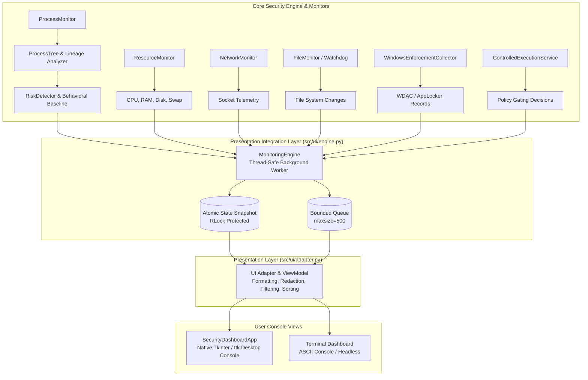

# User Interface and System Integration Architecture (Phase 5)

## 1. Executive Summary

Phase 5 delivers the presentation, telemetry integration, and user console layer for **Endpoint Monitor**. It exposes the complete monitoring pipeline—process tree analysis, behavioral baseline engine, system resource monitoring, network connection tracking, watchdog file auditing, Windows application control telemetry, and controlled execution gating—through an interactive native desktop dashboard and a headless terminal dashboard.

---

## 2. Architecture and Data Flow



---

## 3. Key Design Principles

1. **Non-Blocking Background Execution**:
   - The monitoring engine runs on a dedicated background daemon thread (`EndpointMonitorWorker`).
   - The GUI polls updates non-blockingly via `root.after(1000, ...)` and reads from a bounded event queue (`queue.Queue`).
   - UI redraws, sorting, and user clicks never freeze or delay background process and risk monitoring.
2. **Strict Sensitive-Data Redaction**:
   - All displayed executable paths, command arguments, and publisher metadata pass through `redact_string()` and `redact_command_line()`.
   - Embedded passwords, bearer tokens, API keys, and credentials are eliminated before appearing on screen or in logs.
3. **Fail-Closed Safety Defaults**:
   - `dry_run = True` and `allow_active_execution = False` remain active across the UI.
   - The Controlled Execution console evaluates policies and displays simulated decisions without launching active processes.
4. **Resilience to Transient Errors**:
   - Processes that terminate during UI refresh are handled gracefully with fallback values.
   - Missing or inaccessible metadata is displayed explicitly as `"N/A"` rather than masked or fabricated.

---

## 4. Desktop Dashboard Views

The desktop graphical interface ([`src/ui/dashboard.py`](file:///c:/Users/Sudarshnan/OneDrive/Desktop/endpointmonitor_2/endpoint-monitor/src/ui/dashboard.py)) is organized into six tabs:

### Tab 1 — Overview Dashboard
- **Status Cards**: Active Monitored Processes, High-Severity Alerts, Total Ingested Events, and Execution Gate Status (`DRY-RUN`).
- **Resource Progress Gauges**: Live CPU %, Memory %, and Disk % bars with dynamic threshold warnings.
- **OS Policy Integration Status**: Real-time status of Windows Code Integrity (WDAC) and AppLocker telemetry collection.
- **Recent Critical Alerts**: High-priority alert table displaying timestamp, severity, target process, score, and detection reasons.

### Tab 2 — Process Explorer
- **Interactive Search**: Real-time filtering by process name, PID, path, user context, or detection reason.
- **Severity Filtering**: View `ALL`, `HIGH`, `MEDIUM`, or `LOW` risk processes.
- **Sortable Columns**: Sort by PID, PPID, process name, sanitized path, risk score, severity, and user.
- **Lineage Card**: Selecting any process displays its hierarchical process-tree parentage (e.g. `explorer.exe -> chrome.exe -> cmd.exe`), full command line, and granular risk breakdown.

### Tab 3 — Alerts & Event History
- **Unified Security Timeline**: Displays security events from process monitoring, network monitoring, file changes, Windows application control, and controlled execution.
- **Granular Filters**: Filter by source module and severity.
- **Raw Metadata Inspector**: Selecting an alert displays its complete, formatted JSON metadata payload for forensic review.

### Tab 4 — System Resources
- **Subsystem Breakdown**: In-depth statistics for CPU cores, physical memory (Used/Total/Available), disk mount points and free space, and swap/virtual memory.
- **Sustained Spike Tracker**: Indicates sustained resource threshold violations.

### Tab 5 — Network & File Activity
- **Socket Telemetry**: Real-time connection table showing PID, owning process, protocol, local socket, remote endpoint, and port risk assessment (flagging non-standard ports used by script interpreters).
- **File System Changes**: Audits file creation, modification, deletion, and relocation in the monitored directory.

### Tab 6 — Controlled Execution Console
- **Interactive Policy Evaluator**: Allows security administrators to test execution requests with custom target paths, command-line arguments, and parent PIDs.
- **Decision Feedback**: Displays `ALLOW` or `BLOCK` policy decision, calculated risk score, policy reasons, and safety gate status under dry-run conditions.
- **Execution History**: Table of recent execution submissions and outcomes.

---

## 5. Command-Line & Terminal Dashboard

For headless servers or environments without graphical displays:
```powershell
python src/main.py --cli
```
Renders a live-updating ASCII dashboard displaying system status, CPU/RAM/Disk metrics, active critical alerts, and highest-risk processes. Uses 100% standard ASCII characters to guarantee compatibility across Windows code pages (cp1252/cp437) without encoding errors.

---

## 6. Monitoring Controls & Lifecycle

The UI exposes clean lifecycle controls:
- **▶ Start**: Starts the background worker thread and file system observer. Idempotent: repeated clicks do not create duplicate threads.
- **⏸ Pause / Resume**: Suspends evaluation cycles without tearing down threads or losing active state.
- **⏹ Stop**: Signals workers to shut down cleanly, joins threads, saves baseline profiles, and releases file handles.
- **🔄 Refresh**: Triggers an instantaneous, synchronized telemetry collection cycle.
- **Window Close (`WM_DELETE_WINDOW`)**: Automatically invokes `engine.stop()` to ensure no orphaned background threads remain.

